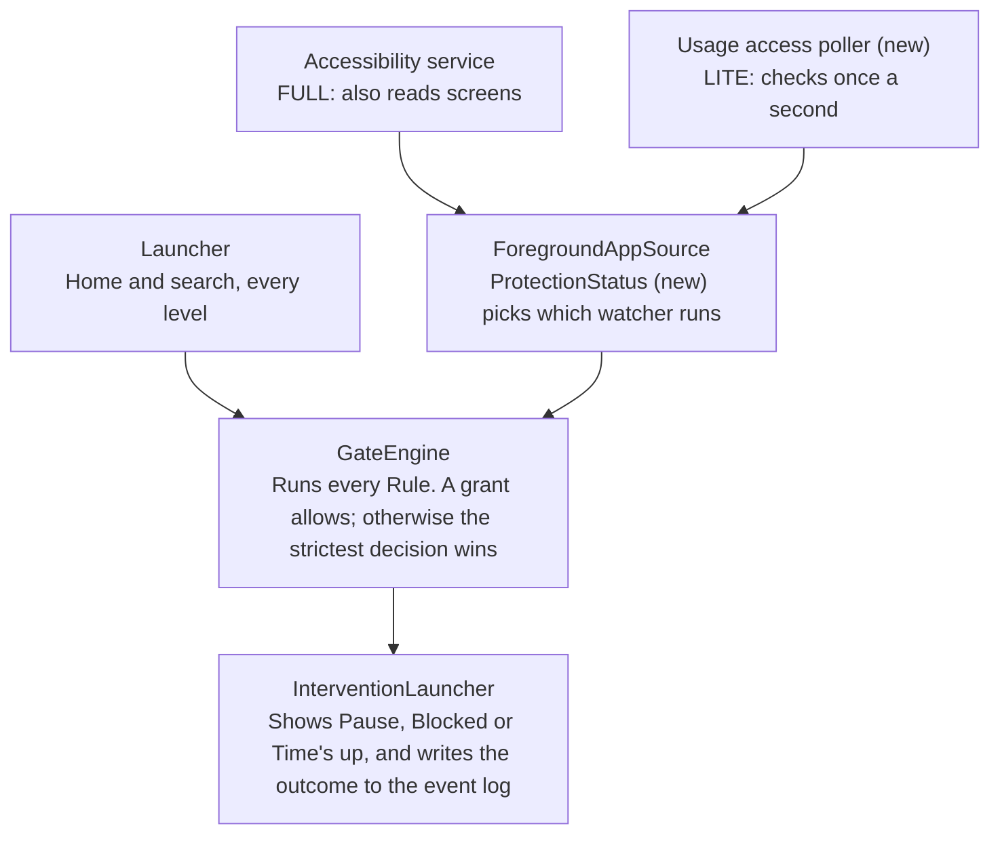

# Minimisation Machine — Beyond Implementation Plan

Nov 24, 2026 · @Shubham

## How to use this plan

This plan carries on from the [implementation plan](Minimisation%20Machine%20—%20Implementation%20Plan.md). Its rules, terms, conventions and the six core building blocks still apply, so read its sections 2 to 5 first. The product reasons for each step are in the [Beyond Plan](Minimisation%20Machine%20—%20Beyond%20Plan.md).

What stays the same:

1. One step per commit, named after it (`Phase 4.3: VIP contacts`). Each step ends with an app that installs and runs, and passes the device checklist.
2. Anything that delays or blocks is a `Rule`. Anything that gates an unlock is an `UnlockMethod`. Every rule setting changes through `SettingsGuard`.
3. No `INTERNET` permission, no analytics, no Google Play Services. F-Droid stays open.
4. Every stat is derived from the event log. Never store a counter.
5. Unclear step: pick the simplest option that fits and leave a `// TODO(question): ...`.

What changes:

- **Phases are independent.** Phase 4 comes first because it protects what already exists. After that, steps within a phase can be built in any order, and any step can be dropped.
- **Each new `Rule` gets a unit test.** Phase 3 shipped `ModeAllowlistRule` without one; step 4.1 adds it.
- **Measure before tuning.** Steps that change a default number (wait steps, budget) log enough events first to tell whether the change helped.

## Architecture additions

The six building blocks stay as they are. Phases 4 to 6 add a second way to see which app is in front, five small interfaces, a few event types and two tables.

Opens from home reach the gate directly, as before. Opens from anywhere else reach it through whichever watcher `ProtectionStatus` has running, so rules and screens don't change.

| Addition | Kind | Step | What it does |
| --- | --- | --- | --- |
| `ProtectionLevel` | Domain enum: `FULL`, `LITE`, `LAUNCHER_ONLY` | 4.2 | Says how much the gate can see. `FULL` is the accessibility service. `LITE` is usage access plus "display over other apps". `LAUNCHER_ONLY` gates opens from home and search only |
| `UsageStatsForegroundSource` | Second producer behind `ForegroundAppSource` | 4.2 | Polls `UsageStatsManager.queryEvents` while accessibility is off. The gate, rules and `UsageTracker` don't change |
| `AppLocker` | Interface: `PlatformAppLocker`, `NoOpAppLocker` | 4.3 | Locks Vault apps at OS level where Android offers it. Below that API level it does nothing |
| `BackupCodec` | Domain class, versioned JSON | 4.4 | Turns settings, rules, lists and key hashes into one file and back. Import goes through `SettingsGuard` |
| `PauseVariant` | Registry keyed by `PauseVariantId`, like `UnlockMethod` | 5.4 | Breathing, one-line note, small sum, name the task. The pause screen shows whichever the rotation picks |
| `ZoneSource` | Domain interface feeding `ActiveModeProvider` | 5.3 | Reports the current zone (a connected Bluetooth device or Wi-Fi network). A mode can be tied to a zone |

New event types: `PROTECTION_CHANGED`, `INTENTION_MET`, `INTENTION_MISSED`, `ZONE_CHANGED`, `PHONE_DOWN`, `RESET_STARTED`, `RESET_ENDED`. The pause variant shown goes in the `data` of `GATE_SHOWN`, so no new type is needed for it.

New tables: `vip_contacts` (5.1) and `zones` (5.3). Everything else is either an event or a scalar in `SettingsStore`.

One rule for the new producer: only one of the two foreground sources runs at a time. The accessibility service wins whenever it's on, so spans are never counted twice.

## Phase 4: protect what works

Phase 4 ends with a first public release, and with a gate that keeps working when the accessibility service is off or taken away.

### 4.1 Close Phase 3's gaps and ship v0.1.0

- Unit test for `ModeAllowlistRule`: no allowlist allows everything; an allowlisted or essential app is allowed; any other app gets `Block` with `WAIT` and `EMERGENCY_PASS`.
- Remove the stray "Lets LauncherApps…" comment above the battery permission in `AndroidManifest.xml`.
- Screenshots of home, pause, blocked and the weekly report, taken from a debug build. Put them in the README and in `fastlane/metadata/android/en-US/images/phoneScreenshots/`.
- Decide on the application ID before tagging. `app.minimise` can't change after the first public release without users reinstalling.
- Run the Release workflow once by hand, then push the tag `v0.1.0`.

**Done when:** CI is green with the new test, and v0.1.0 is a GitHub Release with a signed APK and its checksum.

### 4.2 Protection without accessibility

- `ProtectionStatus` works out the `ProtectionLevel` from `PermissionStatus`: accessibility on is `FULL`; usage access plus "display over other apps" is `LITE`; anything else is `LAUNCHER_ONLY`.
- `UsageStatsForegroundSource`: while the level is `LITE` and the screen is on, read `UsageStatsManager.queryEvents` once a second and emit a `ForegroundEvent` for each `ACTIVITY_RESUMED`. Stop on `SCREEN_OFF`.
- It runs in a foreground service with one quiet ongoing notification, "Protection on". `// TODO(question): foreground service type and its Play declaration.`
- `InterventionLauncher` starts `PauseActivity` from the background, which Android allows for apps that hold "display over other apps".
- Feed blocking, browser coverage and the lock guard need to read screens, so they switch off below `FULL`. Settings says so next to each.
- The home warning names the level: "Protection is Lite: feeds and websites aren't covered."
- Log `PROTECTION_CHANGED` on every change. When Android's Advanced Protection mode has taken accessibility away, the Permissions screen explains that this is the cause.
- Permissions: usage access, display over other apps, `FOREGROUND_SERVICE` and its type permission.

**Done when:** with accessibility off, a Vault app opened from a notification shows the pause within about 2 seconds, its time counts towards the budget, and turning accessibility back on stops the poller with no span counted twice.

### 4.3 OS-level app lock (Android 17 QPR3)

- Android 17 QPR3 brings a system app lock, due for wide release in Q1 2027, that asks for the fingerprint, face or screen-lock PIN. Reports say third-party launchers get APIs for it from QPR2, but none names the API. `// TODO(question): confirm the API and permission; if there isn't one, ship NoOpAppLocker and stop here.`
- `PlatformAppLocker` locks every Vault app while the protection level is below `FULL`, and unlocks them when it's back. It adds a fingerprint step to opens the gate can't see, and hides their notification content.
- Leaving the Vault (a loosening change) unlocks that app when the change applies.

**Done when:** on a phone with the system app lock and accessibility off, a Vault app opened from recents asks for the fingerprint, and the app moved back to Tool no longer does after its 24 hours.

### 4.4 Backup and restore

- **Export** through `ACTION_CREATE_DOCUMENT`: one versioned JSON file from `BackupCodec` with app kinds, websites, budget and taper floor, wait steps, modes, schedules, open limits, feed switches, swaps, digest settings, VIP contacts, and the hashes of keys and friend codes. The event log stays in the CSV export.
- **Import** through `ACTION_OPEN_DOCUMENT`: every difference from the current settings becomes a `SettingChange` and goes through `SettingsGuard`. Tighter applies now, looser waits 24 hours, and nothing loosens during a lock.
- A file from a newer app version is refused with a plain message.

**Done when:** export, clear the app's data and import brings back the Vault, budget and schedules, and an imported budget larger than the current one shows as pending.

### 4.5 Translations and TalkBack

- Counts use plural resources ("1 update", "4 updates"). Accept translations as `values-xx/strings.xml` from contributors.
- Every home row, the pause countdown, the time box choices and the Blocked screen's overrides get labels and roles for TalkBack. The breathing animation stops when the system's "Remove animations" is on.

**Done when:** with TalkBack on, a person can finish onboarding, open a Tool app, and go through a pause and a time box without sighted help.

### 4.6 F-Droid submission

- Check the build is reproducible: build the same tag twice from clean checkouts and compare the APKs.
- Write the `fdroiddata` metadata for the app and open the merge request.

**Done when:** the merge request is open and its build pipeline passes.

## Phase 5: finish the draft, keep the pause working

Phase 5 builds the draft's leftovers and the research-backed changes to the pause and the weekly report. Steps can go in any order, except that 5.6 needs 4.2.

### 5.1 VIP contacts

- `vip_contacts` table: display name and contact lookup URI. Pick people through the system contact picker (`ACTION_PICK`). `// TODO(question): is the picker's one-off grant enough to match later, or is READ_CONTACTS needed?`
- `DigestFilter` gets the notification's people (`Notification.EXTRA_PEOPLE_LIST`). A match on a VIP passes straight through, like a call. Fall back to an exact name match when there's no URI.
- Adding a VIP is loosening (more gets through), so it waits 24 hours. Removing one is tightening. Two new `SettingChange` types.
- The digest settings screen lists VIPs.

**Done when:** a direct WhatsApp message from a VIP arrives at once, while one from anyone else waits for the digest.

### 5.2 Torch gesture

- Long-press the date on home to toggle the torch through `CameraManager.setTorchMode`. Track its state with a torch callback so the gesture always flips it.
- Phones without a flash ignore the gesture.

**Done when:** long-pressing the date turns the torch on, and again turns it off.

### 5.3 Zones

- `zones` table: name, type (`BLUETOOTH` or `WIFI`), the device address or network name, and a mode.
- `ZoneSource` listens for Bluetooth connect and disconnect broadcasts (`BLUETOOTH_CONNECT` permission) and for Wi-Fi through a `NetworkCallback`. Reading a Wi-Fi name needs location permission, so Wi-Fi zones stay off until it's granted.
- `ActiveModeProvider` order becomes: the hand-picked mode, then a zone's mode, then a schedule, then the main settings.
- Adding a zone tied to a stricter mode is tightening. Removing a zone or pointing it at a looser mode is loosening.
- Log `ZONE_CHANGED` on each change.

**Done when:** connecting to the car's Bluetooth switches to the chosen mode, disconnecting switches back, and deleting the zone shows as pending.

### 5.4 Varied pauses

- `PauseVariantId`: `BREATHE` (today's screen), `AFTER_THIS` ("What will you do after this?", one line), `NOTE` ("How do you feel right now?", one line) and `SUM` (one two-digit sum).
- A registry maps each id to its composable, like the `UnlockMethod` registry. The wait still comes from the rules; a variant only fills it. Proceed stays off until the wait is over and the variant is answered.
- Settings: pick which variants rotate; breathing can't be turned off when it's the last one. Rotation comes from today's `GATE_SHOWN` count, like swaps, and the variant shown goes in that event's `data`.
- Choosing variants doesn't change the wait, so it isn't a guarded setting.

**Done when:** with three variants picked, three opens in a row show three different pauses, each lasting the full wait step.

### 5.5 Check-back

- `TimeUpActivity` adds "Did you get what you came for?" with Yes and No, and can be skipped. Log `INTENTION_MET` or `INTENTION_MISSED` with the reason chosen at the pause.
- The weekly report adds one line: "You got what you came for 6 of 10 times", plus the reason that went off track most.
- `// TODO(question): ask after every time box, or one in three?`

**Done when:** answering on Time's up logs the event, and the weekly report's count matches the log.

### 5.6 Gap notice and fresh start

- Also log `PROTECTION_CHANGED` when the app stops or starts being the home app. A **gap** is any stretch at `LAUNCHER_ONLY` or with another home app.
- `ProtectionGaps` (domain, unit-tested) finds gaps in the event log. Home's warning shows the running gap's length; the weekly report lists gaps over an hour.
- After a gap longer than `Defaults.GAP_FRESH_START` (6 hours), the first Vault open uses the last wait step. `VaultPauseRule` reads it from `ProtectionGaps`.

**Done when:** switching accessibility and usage access off for an afternoon shows on home and in the weekly report, and the next Vault open waits the longest step.

### 5.7 Since you started, and one suggestion

- **Since you started:** the baseline is the first full usage week in the event log. The weekly report adds Vault minutes and unlocks against it as a percentage.
- **One suggestion:** `SuggestionFinder` (domain, unit-tested) checks a fixed list and returns at most one tightening: an earlier wind-down when most slips fall in the hour before it, an open limit for the Vault app opened most, or a schedule for the weekday with the most Vault minutes.
- One tap applies it through `SettingsGuard`. "Not now" hides it for a week. Nothing appears on home.

**Done when:** with a week of late-night slips in the log, the report suggests an earlier wind-down, and accepting it applies at once.

## Phase 6: bigger commitments and small tools

Phase 6 is optional work, each step independent. 6.1 has the strongest evidence behind it, so build it first if Phase 6 starts at all.

### 6.1 Two-week reset

- `ResetProgram` (domain) starts in one tightening change: a 14-day lock period plus a built-in **Reset** mode. Reset mode allows Tool apps except browsers, gives the Vault no budget, and turns on the digest and grayscale.
- Overrides during a reset: `EMERGENCY_PASS` only. `// TODO(question): allow friend codes too?`
- Log `RESET_STARTED` and `RESET_ENDED`. The weekly report after a reset compares its two weeks with the two before it.

**Done when:** starting a reset blocks Vault apps and browsers for 14 days, nothing can loosen during it, and the report after it compares the two periods.

### 6.2 Unlock question

- Off by default. On `USER_PRESENT`, if the last question was over an hour ago (`Defaults.UNLOCK_QUESTION_EVERY`), show "What will you do after this?" with a one-line answer and Skip.
- Never on the first unlock of the day, which belongs to the Today screen. The answer goes in the `SCREEN_UNLOCK` event's `data`.

**Done when:** with it on, unlocking asks at most once an hour and never on top of the Today screen.

### 6.3 Move to unlock

- `StepsMethod` (`UnlockMethodId.STEPS`): read the step counter sensor when the user picks it, and unlock once it has risen by `Defaults.UNLOCK_STEPS` (500). Needs the activity recognition permission; unavailable without the sensor.
- `BudgetRule` and `OpenLimitRule` offer it. Locked focus sessions and lock periods don't.

**Done when:** with the budget used, picking Steps and walking 500 steps grants one time box.

### 6.4 Phone down

- A **Phone down** item on home starts a stretch that ends at the next unlock. Log `PHONE_DOWN` with its length.
- The weekly report adds "Phone down 4 h 10 min this week" next to focus minutes.

**Done when:** starting phone down, leaving the phone for 30 minutes and unlocking shows "Phone down 30 min", and the weekly report counts it.

### 6.5 Quick Settings tiles

- `CaptureTileService` opens the capture box. `FocusTileService` starts a 25-minute focus session, or shows the time left in one. Both are thin adapters over existing domain classes.

**Done when:** both tiles can be added, capture opens over any app, and the focus tile starts a session that home shows.

### 6.6 Network brake

- `NetworkBrakeService` extends `VpnService`. Only Vault apps are routed into its tunnel, which drops every packet. When a grant starts or ends, rebuild the tunnel without or with that app.
- Off by default; turning it on is tightening, off is loosening. Unavailable while another VPN is active, since Android allows only one.
- `// TODO(question): confirm a drop-only VpnService needs no INTERNET permission, so the no-network rule holds.`

**Done when:** with the brake on, Instagram can't load its feed outside a time box, loads normally inside one, and Maps is never affected.

### 6.7 Grayscale through Shizuku

- If Shizuku is installed and running, the Permissions screen offers "Grant with Shizuku", which runs the same permission grant through Shizuku. The ADB command stays as the fallback.
- `// TODO(question): check the Shizuku API library's licence fits F-Droid.`

**Done when:** on a phone with Shizuku running, grayscale is granted without a computer.

## Device checklist additions

Add these to the first plan's checklist once the step they test has shipped, and run the whole list after every step as before.

- [ ] (4.2) Accessibility off, usage access on: a Vault app opened from a notification, from recents and from a link still shows the pause.
- [ ] (4.2) Reboot in Lite protection: the poller comes back, and today's numbers survive.
- [ ] (4.2) Switch accessibility on and off while a Vault app is open: no double pause screens, and no span counted twice.
- [ ] (4.2) On Android 17 with Advanced Protection on: the Permissions screen explains why accessibility is gone, and Lite protection takes over.
- [ ] (4.4) Export, uninstall, reinstall and import: the Vault, budget and schedules return, and anything looser shows as pending.
- [ ] (4.5) TalkBack on: home, the pause and the time box all work by touch exploration.
- [ ] (5.3) Connect and disconnect a zone's Bluetooth device twice quickly: the mode settles without flicker or a pause screen loop.
- [ ] (5.4) Rotate the phone on each pause variant: the typed answer and the countdown survive.
- [ ] (6.6) Network brake on: a Vault app loads inside a time box and stops loading within a few seconds of the box ending.
